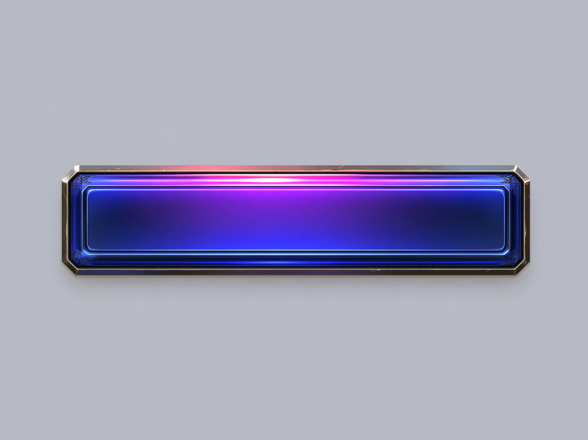
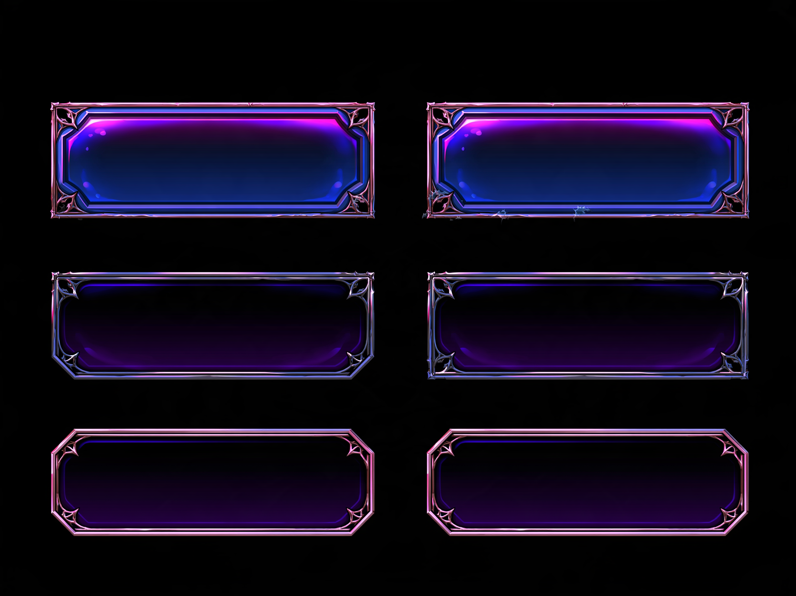

# Hushthorn button redesign — enchanted enamel and cathedral tracery

Status: initial implementation complete. Seven transparent designs, PNG/WebP exports and nine-slice pieces are available in `public/brand/buttons/`.

## Objective

Replace the current mixed pink, purple and indigo button treatments with a consistent family based on the supplied Midjourney artwork. Combine polished sapphire/violet enamel with fine rose-silver cathedral tracery. Support desktop and mobile layouts, preserving existing actions and readable labels.

The approved pink-to-blue `output/cathedral-v1/hushthorn-wordmark-blue.png` is the intended header branding reference. Keep button labels in Cinzel; decorative logo lettering does not replace interface typography.

## Reference artwork

Original copies are stored with this document so the redesign does not depend on files remaining in Downloads.

**Single button:** use its sapphire enamel, violet center, narrow pink highlight, beveled metal edge and small engraved corners. The gray backdrop and ground shadow must be removed during asset preparation. Its heavier frame is a reference for prominent actions, not a requirement for every small control.

**Six-button sheet:** use the top-left design as the proposed primary style, middle-right as secondary, and bottom-left as the quieter outlined style. These selections are starting points for a labeled preview. The sheet contains design variations, not guaranteed matching hover/pressed states. Derive interaction states from one consistent geometry rather than swapping different outlines.

## Button family and current controls

The current implementation lives in `src/App.jsx`, including its `FONT_CSS` block. Recheck current code before implementation; line numbers and component boundaries may change.

| Role | Proposed treatment | Current examples |
| --- | --- | --- |
| Primary | Sapphire/violet enamel, rose highlight, rose-silver tracery corners | + Inscribe, Save cover, primary modal submission |
| Secondary | Dark violet enamel, silver edge, reduced highlight | Inscribe to Wishlist beside Inscribe to Owned, editing actions |
| Quiet | Near-black surface with thin rose-violet outline | Cancel, back and supporting actions |
| Navigation | Shared enamel palette and simplified corner treatment; obvious selected state | Existing Library/Oracle/Codex ribbon controls |
| Icon action | Simplified border and enamel, generous hit area | Close and compact editing controls |
| Destructive | Restrained ruby accent with explicit action text | Removal actions; preserve existing confirmation behavior |

Use primary emphasis for the main action in a group. Preserve contextual meaning when choosing which action is primary. Keep cyan reserved for audio features. Ratings, switches and selection chips retain their existing behavior and need individual review rather than a blanket button replacement.

## Asset preparation

- Extract the selected buttons into separate tightly bounded assets. Remove the outside backgrounds, including gray shadows and black around the sheet, without deleting the dark enamel interiors.
- Export PNG or lossless WebP with real alpha outside the frame. Keep labels and icons out of the artwork.
- Suggested output directory: `public/brand/buttons/`. Proposed names: `enamel-primary`, `enamel-secondary`, and `tracery-quiet`. These role aliases are now exported.
- Use nine-slice borders or separate corner/edge assets plus a CSS enamel center so corners retain their proportions at different widths. Measure slice guides from the finished cutouts; do not guess them from the full reference sheet.
- Avoid stretching a complete fixed-ratio button across narrow and wide controls. Verify that gradient joins remain continuous when slicing; a CSS center may be needed to avoid seams.
- Start with 2× density assets sized from actual rendered border thickness. Record final pixel dimensions, slice guides and byte sizes alongside the exports.
- Preserve the original references. Inspect cutouts on both light and dark backgrounds for gray fringes, missing corners and accidental transparency.

## Responsive rendering and typography

Use semantic HTML buttons with live Cinzel text and existing icons. Decorative layers must not intercept pointer events or become accessible content. Use a shared style/component rather than repeating long class lists; preserve handlers, button types, disabled behavior and form semantics.

- Default touch controls: at least 44×44 CSS px, typically 48 px tall for labeled actions. Compact icon artwork can sit inside a larger hit area.
- Labels: start at 12–14 px, modest tracking, pale pink-white; test actual contrast over the lightest part of the enamel. Target at least 4.5:1 for normal text.
- Allow width to follow content. Reserve enough internal padding that text cannot overlap the tracery.
- At narrow widths, stack paired long actions such as “Inscribe to Owned” and “Inscribe to Wishlist” instead of shrinking labels or clipping them.
- Keep corners squared or subtly clipped, matching the supplied art. Limit ornament at small sizes.
- Provide a CSS gradient and border fallback while images load or if an asset fails.

For a future Expo implementation, retain the same roles and assets but use platform-appropriate stretchable images or layered corners; CSS border-image is not a native implementation plan.

## Interaction states

| State | Behavior |
| --- | --- |
| Default | Restrained gloss and stable outline |
| Hover | Slightly brighter upper reflection and edge, only on hover-capable devices |
| Pressed | Darker enamel/inset highlight; no layout shift |
| Keyboard focus | Clear external focus ring, separated from decorative trim and not clipped |
| Disabled | Muted surface and legible label; actual disabled semantics |
| Loading | Stable width, text such as “Saving…”, accessible busy indication, duplicate submission prevented |
| Selected | Persistent visible marker and appropriate state semantics; do not rely only on glow/color |

Avoid continuous pulsing, moving shimmer or flashing. Respect reduced motion. Keep navigation as navigation; do not add tab roles unless the corresponding tab interaction model is implemented.

## Implementation sequence

1. Prepare primary, secondary and quiet artwork; document slice guides.
2. Build a labeled comparison showing default, hover, pressed, focused, disabled and loading states at desktop/mobile sizes.
3. Introduce reusable button styling with a CSS fallback. Preserve current behavior.
4. Apply first to + Inscribe, the Owned/Wishlist action pair, and Save cover/Cancel. Check long labels and modal width before expanding.
5. Extend to other actions and navigation after reviewing the initial screens. Keep compact controls visually simpler.
6. Integrate the intended header wordmark as a separate explicit change, with an accessible Hushthorn name and preserved proportions.

## Acceptance checklist

- [ ] No gray/black backdrop rectangles, halos or stretched corner details.
- [ ] Clear hierarchy between primary, secondary, quiet and destructive actions.
- [ ] Label contrast verified over the actual artwork; focus remains visible.
- [ ] Keyboard activation, focus order, disabled states and loading behavior preserved.
- [ ] 320, 375, 390 and 768 px layouts plus desktop checked; long labels and 200% zoom do not clip.
- [ ] Touch targets remain usable; hover is not required to understand or activate a control.
- [ ] Image failure fallback and reduced-motion behavior checked.
- [ ] Existing navigation, save, cancel and modal behavior verified.
- [ ] Final asset sizes recorded; use shared assets rather than duplicated per-button downloads.
- [ ] `npm run build` passes after implementation.

Implemented: `src/components/EnamelButton.jsx` and its CSS provide primary, secondary, quiet and metal variants; live labels; hover, pressed, focus, disabled and loading states. Applied to + Inscribe, Inscribe to Owned/Wishlist, and Save cover/Cancel. Other controls and header branding remain outside this initial rollout.

All six sheet designs and the single metal design are exported separately. Each has nine physical WebP slices; the component uses CSS border-image with equivalent 48-source-pixel slices rendered at 14 CSS px. Dimensions and byte sizes are in `public/brand/buttons/manifest.json`. Image generation performed the background removal, so the cutouts may differ slightly from the original reference.

Review page: run `npm run dev` and open `/button-preview.html`. Browser preview confirmed rendering, activation, disabled loading state and keyboard navigation. Build passed; full authenticated app regression and device-specific mobile QA remain pending.

## QA pass (2026-10-01)

Fixed: fallback gradient showed as a lighter rectangle behind every button (it filled the corners the art cuts away) — now clipped inside the frame on `::before`; label backing removed on primary/secondary/quiet (13.5:1 or better measured over the raw art, 4.5:1 target) and kept on metal (1.6:1 worst case). Verified on staging: image-failure fallback, 2px focus ring, stable width while loading, 50px height, no horizontal overflow at 390px, modal opens from + Inscribe. Screenshots: `output/button-redesign-qa/`.

Still open: 320/375/768 px and 200% zoom, keyboard activation inside the Inscribe and cover-editor modals, long-label check, rollout to navigation / icon actions / destructive actions, header wordmark (separate change). Weight note: `public/brand/buttons` is 2.3 MB because source PNGs and slice folders ship with it; the app loads four WebPs (~100 KB). Move the sources out of `public/` before this goes to production if deploy size matters.
